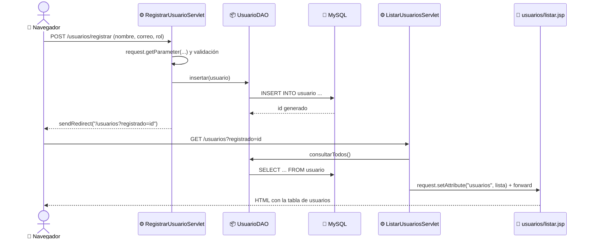
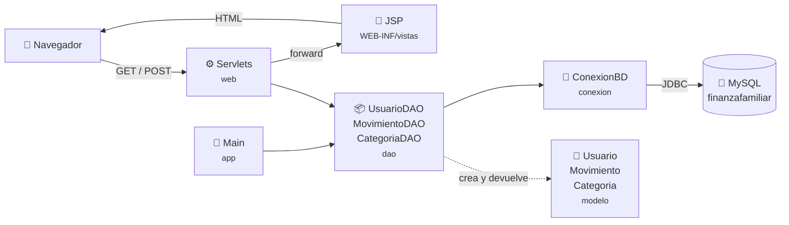
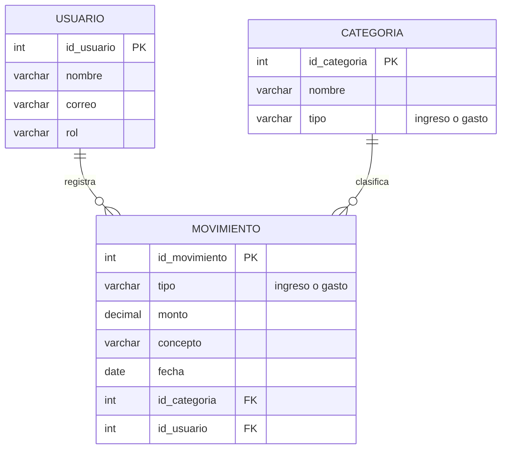

<div align="center">

# 💰 FinanzaFamiliarBackend

### Sistema de Contabilidad Familiar — Java + Servlets + JSP + JDBC + MySQL

Módulos de **Usuarios** y **Movimientos** (ingresos y gastos del hogar): CRUD con JDBC probado en consola y **aplicación web** con formularios HTML, servlets (`GET` y `POST`) y páginas JSP.


**SENA · Tecnólogo en Análisis y Desarrollo de Software (ADSO) · Ficha 3336193**

</div>

---

## 📑 Tabla de contenido

1. [¿Qué hace este proyecto?](#-qué-hace-este-proyecto)
2. [Requisitos previos](#-requisitos-previos)
3. [Paso 1 — Clonar el repositorio](#-paso-1--clonar-el-repositorio)
4. [Paso 2 — Crear la base de datos en MySQL Workbench](#-paso-2--crear-la-base-de-datos-en-mysql-workbench)
5. [Paso 3A — Ejecutar con IntelliJ IDEA](#-paso-3a--ejecutar-con-intellij-idea)
6. [Paso 3B — Ejecutar con NetBeans](#-paso-3b--ejecutar-con-netbeans)
7. [Paso 3C — Ejecutar desde la terminal (opcional)](#-paso-3c--ejecutar-desde-la-terminal-opcional)
8. [Resultado esperado](#-resultado-esperado)
9. [Paso 4 — Ejecutar la aplicación web](#-paso-4--ejecutar-la-aplicación-web)
10. [¿Cómo funciona la parte web?](#-cómo-funciona-la-parte-web)
11. [Estructura del proyecto](#-estructura-del-proyecto)
12. [Modelo de la base de datos](#-modelo-de-la-base-de-datos)
13. [Solución de problemas](#-solución-de-problemas)
14. [Estándares de codificación](#-estándares-de-codificación)
15. [Trabajo en equipo con Git](#-trabajo-en-equipo-con-git)
16. [Autores](#-autores)

---

## 🎯 ¿Qué hace este proyecto?

El proyecto se conecta a MySQL por medio de **JDBC** y tiene dos formas de uso:

| Parte | ¿Qué hace? | Evidencia | Cómo se ejecuta |
|:--|:--|:--|:--|
| 🖥️ **Consola** | `Main.java` prueba el CRUD completo de los dos módulos | `GA7-220501096-AA2-EV01` | [Paso 3](#-paso-3a--ejecutar-con-intellij-idea) |
| 🌐 **Web** | Formularios HTML que envían datos a servlets por `GET` y `POST`, y páginas JSP que muestran los resultados | `GA7-220501096-AA2-EV02` | [Paso 4](#-paso-4--ejecutar-la-aplicación-web) |

| Módulo | Tabla | Crear | Consultar | Actualizar | Eliminar | Web |
|:--|:--|:--:|:--:|:--:|:--:|:--|
| 👤 **Usuarios** | `usuario` | ✅ | ✅ | ✅ | ✅ | Registrar (POST) y buscar por nombre (GET) |
| 💸 **Movimientos** | `movimiento` | ✅ | ✅ | ✅ | ✅ | Registrar (POST) y filtrar por tipo (GET) |

Todas las consultas usan `PreparedStatement` para evitar inyección SQL, y las conexiones se cierran solas con `try-with-resources`.

---

## 🧰 Requisitos previos

Instala lo siguiente **antes de empezar**:

| Herramienta | Versión | ¿Para qué? | Descarga |
|:--|:--|:--|:--|
| ☕ **JDK** | 17 o superior | Compilar y ejecutar Java | [Oracle JDK](https://www.oracle.com/java/technologies/downloads/) |
| 🐬 **MySQL Server** | 8.0 o superior | Motor de base de datos | [MySQL Installer](https://dev.mysql.com/downloads/installer/) |
| 🛠️ **MySQL Workbench** | 8.0 o superior | Ejecutar los scripts SQL | Se instala junto con MySQL Installer |
| 💻 **IDE** | IntelliJ IDEA **o** NetBeans | Abrir y ejecutar el proyecto | [IntelliJ](https://www.jetbrains.com/idea/download/) · [NetBeans](https://netbeans.apache.org/front/main/download/) |
| 🌿 **Git** | Cualquiera | Clonar el repositorio | [git-scm.com](https://git-scm.com/downloads) |

> [!NOTE]
> **No necesitas descargar el driver de MySQL (`.jar`) a mano.** El proyecto usa **Maven**, que lo descarga automáticamente la primera vez que se abre el proyecto (se necesita internet). Tampoco hace falta instalar Maven: IntelliJ y NetBeans ya lo traen incluido.
>
> **Tampoco necesitas instalar Tomcat.** La aplicación web se ejecuta con un servidor **Jetty** que Maven descarga y arranca solo (`jetty:run`).

> [!IMPORTANT]
> Ten a mano la **contraseña del usuario `root` de MySQL**, la que pusiste al instalar MySQL Server. La vas a necesitar en el Paso 2.

---

## 📥 Paso 1 — Clonar el repositorio

Abre una terminal (Git Bash, PowerShell o CMD) en la carpeta donde quieras guardar el proyecto y ejecuta:

```bash
git clone https://github.com/moralessaiz/FinanzaFamiliarBackend.git 
cd FinanzaFamiliarBackend
```

> 💡 También puedes descargarlo como ZIP desde GitHub: botón verde **Code → Download ZIP**, y descomprimirlo.

---

## 🐬 Paso 2 — Crear la base de datos en MySQL Workbench

El proyecto trae **dos scripts SQL** en la carpeta [`sql/`](sql/), que se ejecutan **en este orden**:

| Orden | Script | ¿Qué hace? |
|:--:|:--|:--|
| 1️⃣ | [`finanzafamiliar_movimientos.sql`](sql/finanzafamiliar_movimientos.sql) | Crea la base de datos `finanzafamiliar`, las tablas `usuario`, `categoria` y `movimiento`, y los datos iniciales |
| 2️⃣ | [`crear_usuario_bd.sql`](sql/crear_usuario_bd.sql) | Crea el usuario de MySQL `finanza_user`, que es el que usa Java para conectarse |

### 2.1 Verificar que MySQL esté encendido

1. Presiona `Win + R`, escribe `services.msc` y presiona **Enter**.
2. Busca el servicio **MySQL80** (o `MySQL`).
3. Su estado debe ser **En ejecución**. Si no lo está: clic derecho → **Iniciar**.

### 2.2 Conectarse como `root`

1. Abre **MySQL Workbench**.
2. En la pantalla de inicio, en **MySQL Connections**, haz clic en **Local instance MySQL80**.
3. Escribe la contraseña de `root` y presiona **OK**.

<details>
<summary>🔧 <b>¿No aparece ninguna conexión? Haz clic aquí para crearla</b></summary>

<br>

1. Haz clic en el botón **⊕** al lado de *MySQL Connections*.
2. Llena el formulario así:

   | Campo | Valor |
   |:--|:--|
   | Connection Name | `Local` |
   | Hostname | `127.0.0.1` |
   | Port | `3306` |
   | Username | `root` |

3. Presiona **Test Connection**, escribe la contraseña de `root` y confirma que diga *Successfully made the MySQL connection*.
4. Presiona **OK** y luego haz clic en la nueva conexión para abrirla.

</details>

### 2.3 Ejecutar el script de la base de datos y las tablas

1. Ve al menú **File → Open SQL Script…** (`Ctrl + Shift + O`).
2. Busca la carpeta del proyecto y abre `sql/finanzafamiliar_movimientos.sql`.
3. Presiona el botón del **rayo ⚡** de la barra de herramientas (o `Ctrl + Shift + Enter`).
4. Revisa el panel **Output** en la parte inferior: todas las filas deben tener un ✔️ **verde**.

> [!WARNING]
> Hay **dos rayos** en la barra. Usa el **rayo solo ⚡** (ejecuta todo el script).
> El **rayo con cursor** (`Ctrl + Enter`) ejecuta **solo la línea** donde está el cursor.

> [!CAUTION]
> Ejecuta este script **una sola vez**. Si lo vuelves a ejecutar, los usuarios y categorías de ejemplo quedarán **duplicados**. Si necesitas empezar de cero, ejecuta primero `DROP DATABASE finanzafamiliar;` y luego el script otra vez.

### 2.4 Ejecutar el script del usuario de conexión

1. Abre de la misma forma el archivo `sql/crear_usuario_bd.sql`.
2. Ejecútalo con el **rayo ⚡**.
3. Al final aparece una pestaña de resultados con los permisos del usuario (`SHOW GRANTS`). Si la ves, todo salió bien ✅.

Este script crea el siguiente usuario, que coincide con los datos de [`ConexionBD.java`](src/main/java/com/finanzafamiliar/contabilidad/conexion/ConexionBD.java):

| Dato | Valor |
|:--|:--|
| 🖥️ Servidor | `localhost:3306` |
| 🗄️ Base de datos | `finanzafamiliar` |
| 👤 Usuario | `finanza_user` |
| 🔑 Contraseña | `Finanza2026*` |
| 🔐 Permisos | `SELECT`, `INSERT`, `UPDATE`, `DELETE` sobre `finanzafamiliar` |

> 💡 Si quieres usar otro usuario o contraseña, cámbialos **en los dos lugares**: en `sql/crear_usuario_bd.sql` y en las constantes `USUARIO` y `CONTRASENA` de `ConexionBD.java`.

### 2.5 Verificar que todo quedó creado

1. En el panel izquierdo **Navigator → Schemas**, presiona el botón 🔄 (*refresh*).
2. Debe aparecer la base de datos **`finanzafamiliar`** con sus tres tablas:

   ```
   📁 finanzafamiliar
    └── 📁 Tables
         ├── 📄 categoria
         ├── 📄 movimiento
         └── 📄 usuario
   ```

3. Para ver los datos: clic derecho sobre `usuario` → **Select Rows – Limit 1000**. Deben aparecer **2 usuarios**:

   | id_usuario | nombre | correo | rol |
   |:--:|:--|:--|:--|
   | 1 | Amalfi Aya | amalfi.aya@finanzafamiliar.com | Administradora |
   | 2 | Cristhian Morales | cristhian.morales@finanzafamiliar.com | Integrante |

   Y en `categoria`, **4 categorías**: Salario, Arriendo, Mercado y Servicios públicos.

🎉 **¡La base de datos está lista!** Ahora elige tu IDE: [IntelliJ IDEA](#-paso-3a--ejecutar-con-intellij-idea) o [NetBeans](#-paso-3b--ejecutar-con-netbeans).

---

## 🟣 Paso 3A — Ejecutar con IntelliJ IDEA

### Abrir el proyecto

1. Abre IntelliJ IDEA → **File → Open…**
2. Selecciona la carpeta **`FinanzaFamiliarBackend`** (la que contiene el archivo `pom.xml`) y presiona **OK**.
3. Si pregunta, elige **Open as Project** y luego **Trust Project**.
4. Espera a que termine la barra de progreso inferior: IntelliJ está descargando el driver de MySQL con Maven.

### Configurar el JDK

1. Ve a **File → Project Structure…** (`Ctrl + Alt + Shift + S`).
2. En la sección **Project**:
   - **SDK:** selecciona tu JDK (17 o superior).
   - **Language level:** `17`.
3. Presiona **Apply → OK**.

> 💡 Si tu JDK no aparece en la lista: **Add SDK → JDK…** y busca la carpeta donde está instalado, por ejemplo `C:\Program Files\Java\jdk-25`.

### Cargar las dependencias de Maven

1. Abre el panel **Maven** (ícono **m** en la barra lateral derecha).
2. Presiona 🔄 **Reload All Maven Projects**.
3. En **Dependencies** debe aparecer `com.mysql:mysql-connector-j:26.7.0`.

### Ejecutar la prueba de consola

1. En el panel **Project**, abre `src/main/java/com/finanzafamiliar/contabilidad/app/Main.java`.
2. Haz clic en el ▶️ **verde** que aparece al lado de `public static void main` → **Run 'Main.main()'**.
3. El resultado aparece en la consola inferior → mira el [resultado esperado](#-resultado-esperado).

---

## 🔵 Paso 3B — Ejecutar con NetBeans

> [!NOTE]
> Este proyecto es de tipo **Maven**, no **Ant** (el tipo que NetBeans usa por defecto en *Java with Ant*). NetBeans abre proyectos Maven directamente: **no hay que crear un proyecto nuevo, ni agregar el `.jar` en *Libraries***.

### Abrir el proyecto

1. Abre NetBeans → **File → Open Project…** (`Ctrl + Shift + O`).
2. Busca la carpeta **`FinanzaFamiliarBackend`**. NetBeans la muestra con un ícono especial de Maven (**ma**) porque contiene el `pom.xml`.
3. Selecciónala y presiona **Open Project**.
4. La primera vez, NetBeans descarga las dependencias. Si el proyecto aparece con un ⚠️ o en rojo, clic derecho sobre el proyecto → **Resolve Project Problems…** → **Resolve**, o bien clic derecho → **Build with Dependencies**.

### Configurar el JDK

1. Si tu JDK no está registrado: **Tools → Java Platforms → Add Platform…** → selecciona la carpeta del JDK (17 o superior) → **Finish**.
2. Clic derecho sobre el proyecto → **Properties**.
3. En **Build → Compile**, selecciona tu JDK en **Java Platform**.
4. En **Sources**, verifica que **Source/Binary Format** sea `17`.
5. Presiona **OK**.

### Ejecutar la prueba de consola

En *Projects*, abre **Source Packages → `com.finanzafamiliar.contabilidad.app`**, clic derecho sobre `Main.java` → **Run File** (`Shift + F6`).

> [!NOTE]
> El botón **Run Project** (`F6`) ya no sirve para la consola: como el proyecto ahora es una aplicación web (`war`), NetBeans intenta desplegarlo en un servidor. Para la parte web sigue el [Paso 4](#-paso-4--ejecutar-la-aplicación-web).

El resultado aparece en la ventana **Output** → mira el [resultado esperado](#-resultado-esperado).

> 💡 NetBeans puede crear los archivos `nb-configuration.xml` o `nbactions.xml` en la raíz del proyecto. Son configuraciones locales de NetBeans y no afectan a IntelliJ.

---

## ⌨️ Paso 3C — Ejecutar desde la terminal (opcional)

Solo si tienes [Apache Maven](https://maven.apache.org/download.cgi) instalado y en el `PATH`:

```bash
mvn compile exec:java
```

---

## ✅ Resultado esperado

Si todo está bien configurado, la consola mostrará algo parecido a esto (los `id` pueden variar según cuántas veces hayas ejecutado el programa):

```text
=== FinanzaFamiliar - Modulo de Usuarios (CRUD con JDBC) ===

[CREATE] Usuario insertado con id: 3

[READ] Listado de usuarios registrados:
  Usuario{idUsuario=1, nombre='Amalfi Aya', correo='amalfi.aya@finanzafamiliar.com', rol='Administradora'}
  Usuario{idUsuario=2, nombre='Cristhian Morales', correo='cristhian.morales@finanzafamiliar.com', rol='Integrante'}
  Usuario{idUsuario=3, nombre='Laura Morales', correo='laura.morales@finanzafamiliar.com', rol='Integrante'}

[READ] Usuario consultado por id (3): Usuario{idUsuario=3, nombre='Laura Morales', ...}

[UPDATE] Usuario actualizado: true
[UPDATE] Nuevo estado: Usuario{idUsuario=3, ..., correo='laura.m@finanzafamiliar.com', rol='Administradora'}

[DELETE] Usuario con id 3 eliminado: true
...

=== FinanzaFamiliar - Modulo de Movimientos (CRUD con JDBC) ===

[CREATE] Movimiento insertado con id: 1
[CREATE] Movimiento insertado con id: 2
...
[UPDATE] Movimiento actualizado: true
[DELETE] Movimiento con id 1 eliminado: true
...

=== Prueba de CRUD finalizada correctamente ===
```

> [!NOTE]
> El usuario de prueba (*Laura Morales*) se **elimina al final** de su prueba, así que la tabla `usuario` no se llena de registros repetidos. En cambio, la prueba de movimientos deja guardado **un gasto** cada vez que se ejecuta.

---

## 🌐 Paso 4 — Ejecutar la aplicación web

> [!IMPORTANT]
> La base de datos debe estar creada ([Paso 2](#-paso-2--crear-la-base-de-datos-en-mysql-workbench)) y el servicio de MySQL encendido.

### 🟣 Con IntelliJ IDEA

1. Abre el panel **Maven** (ícono **m** de la barra lateral derecha) y presiona 🔄 **Reload All Maven Projects**.
2. Despliega **finanzafamiliar-backend → Plugins → jetty**.
3. Haz **doble clic en `jetty:run`**.
4. Espera a que la consola muestre:

   ```text
   [INFO] Started ServerConnector@...{HTTP/1.1, (http/1.1)}{0.0.0.0:8081}
   [INFO] Started oejs.Server@...
   ```

5. Abre en el navegador 👉 **http://localhost:8081/**

> 💡 Si quieres tenerlo como botón ▶️, haz clic derecho sobre `jetty:run` → **Modify Run Configuration…** → **OK**. Queda guardado en el selector de ejecución de la barra superior.

### 🔵 Con NetBeans

1. Clic derecho sobre el proyecto → **Run Maven → Goals…**
2. En **Goals** escribe `jetty:run`, marca **Remember as:** `Jetty` y presiona **OK**.
3. Cuando la ventana **Output** diga `Started ServerConnector ... 8081`, abre **http://localhost:8081/**
4. Las siguientes veces: clic derecho → **Run Maven → Jetty**.

### ⌨️ Desde la terminal

```bash
mvn jetty:run
```

### Detener el servidor

La consola se queda "pegada" mientras el servidor está encendido. Eso es normal: está esperando peticiones del navegador. Para apagarlo, presiona el cuadro rojo ⏹ del IDE, o `Ctrl + C` en la terminal.

### Páginas disponibles

| URL | Servlet | Método | ¿Qué muestra? |
|:--|:--|:--:|:--|
| `http://localhost:8081/` | — (`index.jsp`) | GET | Página de inicio con los dos módulos |
| `/usuarios` | `ListarUsuariosServlet` | GET | Lista de integrantes del grupo familiar |
| `/usuarios?nombre=cris` | `ListarUsuariosServlet` | GET | Búsqueda de usuarios por nombre |
| `/usuarios/registrar` | `RegistrarUsuarioServlet` | GET | Formulario vacío para registrar un usuario |
| `/usuarios/registrar` | `RegistrarUsuarioServlet` | **POST** | Guarda el usuario enviado por el formulario |
| `/movimientos` | `ListarMovimientosServlet` | GET | Lista de ingresos y gastos |
| `/movimientos?tipo=gasto` | `ListarMovimientosServlet` | GET | Filtro por tipo (`ingreso`, `gasto` o `todos`) |
| `/movimientos/registrar` | `RegistrarMovimientoServlet` | GET | Formulario con categorías y usuarios cargados desde MySQL |
| `/movimientos/registrar` | `RegistrarMovimientoServlet` | **POST** | Guarda el movimiento enviado por el formulario |

### Prueba rápida

1. Entra a **Registrar usuario**, llena el formulario y presiona **Guardar usuario**. Debes llegar a la lista con el mensaje verde *"Usuario registrado correctamente (id …)"*.
2. Escribe parte del nombre en **Buscar por nombre** y presiona **Buscar**. Fíjate que la URL cambia a `/usuarios?nombre=...`: eso es **GET**.
3. Entra a **Registrar movimiento**. El nuevo usuario ya aparece en la lista **Registrado por**. Guarda un gasto.
4. En **Movimientos**, cambia el filtro a **Gastos**. La URL cambia a `/movimientos?tipo=gasto`.
5. Prueba la validación del servlet: registra un usuario cuyo nombre sean **solo espacios**. El navegador lo deja pasar, pero el servlet lo rechaza: aparece un mensaje rojo y el formulario conserva lo que habías escrito.

---

## 🧠 ¿Cómo funciona la parte web?

### Recorrido de una petición

El proyecto sigue el patrón **MVC**: el **servlet** es el controlador, la **JSP** es la vista y el **modelo/DAO** maneja los datos.



1. El **formulario HTML** dice a qué URL enviar los datos (`action`) y con qué método (`method="get"` o `method="post"`).
2. La anotación **`@WebServlet("/usuarios/registrar")`** conecta esa URL con la clase Java.
3. El servidor llama a **`doGet`** o a **`doPost`**, según el método del formulario.
4. El servlet lee los campos con **`request.getParameter("nombre")`**, valida y llama al **DAO**.
5. Para mostrar datos, guarda el resultado con **`request.setAttribute(...)`** y hace **`forward`** a la JSP.
6. La **JSP** lee el atributo y genera el HTML que ve el usuario.

### GET vs POST

| | **GET** | **POST** |
|:--|:--|:--|
| ¿Dónde viajan los datos? | En la URL: `/usuarios?nombre=cris` | En el cuerpo de la petición (no se ven en la URL) |
| ¿Para qué se usa? | Consultar, buscar, filtrar | Crear o modificar datos |
| En este proyecto | Buscar usuarios, filtrar movimientos, abrir formularios | Guardar usuarios y movimientos |
| Método del servlet | `doGet(request, response)` | `doPost(request, response)` |
| ¿Se puede guardar en favoritos? | ✅ Sí | ❌ No |

Después de un POST exitoso, el servlet **no** muestra la JSP directamente: hace `response.sendRedirect(...)` hacia la lista. Así, si el usuario recarga la página (F5), el navegador repite el GET y no guarda el registro dos veces. A esto se le llama patrón **POST-Redirect-GET**.

### `forward` vs `sendRedirect`

| | `request.getRequestDispatcher(vista).forward(...)` | `response.sendRedirect(url)` |
|:--|:--|:--|
| ¿Qué pasa? | El servidor pasa la misma petición a la JSP | El servidor le dice al navegador que pida otra URL |
| ¿Cambia la URL del navegador? | No | Sí |
| ¿Se conservan los atributos? | ✅ Sí (`setAttribute`) | ❌ No (se envían como parámetro, por ejemplo `?registrado=5`) |
| En este proyecto | Mostrar listas y formularios, y los mensajes de error | Después de guardar con POST |

### Elementos JSP utilizados

| Elemento | Sintaxis | ¿Para qué? | Dónde verlo |
|:--|:--|:--|:--|
| **Directiva `page`** | `<%@ page import="..." %>` | Configura la página e importa clases Java | Todas las JSP |
| **Directiva `include`** | `<%@ include file="pie.jspf" %>` | Copia otro archivo dentro de la JSP **antes** de compilarla (inclusión estática) | Pie de página |
| **Acción `<jsp:include>`** | `<jsp:include page="..."><jsp:param .../></jsp:include>` | Ejecuta otra JSP en **cada petición** y le pasa parámetros (inclusión dinámica) | Menú de navegación (`encabezado.jsp`) |
| **Scriptlet** | `<% for (Usuario u : usuarios) { %>` | Código Java: ciclos, condiciones, variables | Tablas de `listar.jsp` |
| **Expresión** | `<%= u.getNombre() %>` | Imprime un valor dentro del HTML | Celdas de las tablas |
| **Declaración** | `<%! private String saludoSegunHora() { ... } %>` | Declara un método o atributo de la página | `index.jsp` |
| **Comentario JSP** | `<%-- ... --%>` | Comentario que **no** llega al navegador (a diferencia de `<!-- -->`) | Todas las JSP |
| **Objetos implícitos** | `request`, `response` | Disponibles en toda JSP sin declararlos | `request.getAttribute(...)`, `request.getContextPath()` |

### Detalles de seguridad y buenas prácticas

- 🔒 Las JSP están dentro de **`WEB-INF/vistas/`**. El navegador no puede abrirlas directamente: siempre pasan por un servlet, que es el que les entrega los datos.
- 🛡️ Todo texto escrito por el usuario se imprime con **`HtmlUtil.escapar(...)`**. Si alguien escribe `<script>` en el concepto, se muestra como texto y no se ejecuta (protección contra **XSS**).
- 💉 Los DAO siguen usando **`PreparedStatement`**, así que los datos del formulario no pueden alterar el SQL (protección contra **inyección SQL**).
- ✅ Los datos se validan **dos veces**: en el navegador (`required`, `type="email"`, `min="0"`) y en el servlet, porque la validación del navegador se puede saltar.
- 🔤 `request.setCharacterEncoding("UTF-8")` y `<page-encoding>UTF-8</page-encoding>` en `web.xml` hacen que las tildes y la **ñ** se guarden y se muestren bien.

> [!NOTE]
> **Diferencia con el proyecto de NetBeans de Amalfi:** su versión usa `javax.servlet` con Tomcat 7. Este proyecto usa **`jakarta.servlet`** (Jakarta EE 10) con Jetty 12, porque Tomcat 7 no es compatible con los JDK actuales. El código de los servlets es el mismo: solo cambian los `import`. El `.war` generado (`target/finanzafamiliar.war`) también funciona en **Tomcat 10.1 o superior**.

---

## 🗂️ Estructura del proyecto

```text
FinanzaFamiliarBackend/
├── 📄 pom.xml                         ← Configuración de Maven (war, Java 17, Servlet/JSP, driver MySQL, Jetty)
├── 📄 README.md                       ← Este archivo
├── 📄 .gitignore
├── 📁 sql/
│   ├── finanzafamiliar_movimientos.sql   ← 1️⃣ Base de datos, tablas y datos iniciales
│   └── crear_usuario_bd.sql              ← 2️⃣ Usuario de MySQL para la aplicación
└── 📁 src/main/
    ├── 📁 java/com/finanzafamiliar/contabilidad/
    │   ├── 📁 app/
    │   │   └── Main.java                     ← Prueba de consola del CRUD de ambos módulos
    │   ├── 📁 conexion/
    │   │   └── ConexionBD.java               ← Abre y cierra la conexión JDBC
    │   ├── 📁 modelo/
    │   │   ├── Usuario.java                  ← POJO de la tabla usuario
    │   │   ├── Movimiento.java               ← POJO de la tabla movimiento
    │   │   └── Categoria.java                ← POJO de la tabla categoria
    │   ├── 📁 dao/
    │   │   ├── UsuarioDAO.java               ← CRUD de usuarios + búsqueda por nombre
    │   │   ├── MovimientoDAO.java            ← CRUD de movimientos + filtro por tipo
    │   │   └── CategoriaDAO.java             ← Consulta de categorías para el formulario
    │   └── 📁 web/
    │       ├── ListarUsuariosServlet.java       ← GET  /usuarios
    │       ├── RegistrarUsuarioServlet.java     ← GET y POST /usuarios/registrar
    │       ├── ListarMovimientosServlet.java    ← GET  /movimientos
    │       ├── RegistrarMovimientoServlet.java  ← GET y POST /movimientos/registrar
    │       └── HtmlUtil.java                    ← Escapa textos para evitar XSS
    └── 📁 webapp/
        ├── index.jsp                         ← Página de inicio
        ├── 📁 css/
        │   └── estilos.css
        └── 📁 WEB-INF/                       ← Carpeta protegida: el navegador no la puede abrir
            ├── web.xml                       ← Descriptor de despliegue
            └── 📁 vistas/
                ├── 📁 fragmentos/
                │   ├── encabezado.jsp        ← Encabezado y menú (<jsp:include>)
                │   └── pie.jspf              ← Pie de página (<%@ include %>)
                ├── 📁 usuarios/
                │   ├── listar.jsp
                │   └── registrar.jsp
                └── 📁 movimientos/
                    ├── listar.jsp
                    └── registrar.jsp
```

### ¿Cómo se comunican las capas?



| Paquete / carpeta | Responsabilidad |
|:--|:--|
| `app` | Ejecuta la prueba de consola y muestra los resultados |
| `web` | **Controladores**: servlets que reciben las peticiones GET y POST, validan y eligen qué vista mostrar |
| `webapp/WEB-INF/vistas` | **Vistas**: páginas JSP que generan el HTML |
| `dao` | *Data Access Object*: contiene el SQL de cada tabla (insertar, consultar, actualizar, eliminar) |
| `conexion` | Centraliza los datos de conexión y entrega objetos `Connection` |
| `modelo` | Clases simples (POJO) que representan una fila de cada tabla |

---

## 🗄️ Modelo de la base de datos



- Un **usuario** puede registrar muchos **movimientos**.
- Una **categoría** puede clasificar muchos **movimientos**.
- No se puede eliminar un usuario que tenga movimientos registrados: MySQL lo impide por la llave foránea `fk_movimiento_usuario`.

---

## 🩺 Solución de problemas

| ❌ Mensaje de error | 🔍 Causa | ✅ Solución |
|:--|:--|:--|
| `Access denied for user 'finanza_user'@'localhost'` | No se ha creado el usuario de MySQL | Ejecuta `sql/crear_usuario_bd.sql` en Workbench ([Paso 2.4](#24-ejecutar-el-script-del-usuario-de-conexión)) |
| `Unknown database 'finanzafamiliar'` | No se ha creado la base de datos | Ejecuta `sql/finanzafamiliar_movimientos.sql` ([Paso 2.3](#23-ejecutar-el-script-de-la-base-de-datos-y-las-tablas)) |
| `Communications link failure` | El servidor MySQL está apagado | Inicia el servicio **MySQL80** ([Paso 2.1](#21-verificar-que-mysql-esté-encendido)) |
| `Cannot add or update a child row: a foreign key constraint fails` | El movimiento usa un `id_usuario` o `id_categoria` que no existe | Verifica que la tabla `usuario` tenga el id `1` y `categoria` los ids `1` y `3` |
| `Cannot delete or update a parent row` | Intentas eliminar un usuario que tiene movimientos | Es el comportamiento esperado. Elimina primero sus movimientos |
| `java: JDK isn't specified for module` *(IntelliJ)* | El proyecto no tiene JDK asignado | **File → Project Structure → Project → SDK** ([Paso 3A](#configurar-el-jdk)) |
| `No se encontro el driver JDBC de MySQL` | Maven no descargó las dependencias | IntelliJ: panel Maven → 🔄 Reload. NetBeans: clic derecho → **Build with Dependencies**. Verifica tu conexión a internet |
| `package com.mysql... does not exist` / clases en rojo | Las dependencias no se han cargado | Igual que el caso anterior |
| `invalid target release: 17` | El JDK instalado es anterior a la versión 17 | Instala JDK 17 o superior y selecciónalo en el IDE |
| `The XML schema [XMLSchema.dtd] could not be found` *(al iniciar Jetty)* | Es solo una **advertencia** de Jetty 12.0 al leer `web.xml` | Ignórala. Si más abajo aparece `Started ServerConnector ... 8081`, el servidor está funcionando |
| `Failed to bind to 0.0.0.0/0.0.0.0:8081` / `Address already in use` | Ya hay otro servidor usando el puerto 8081 (por ejemplo, un `jetty:run` anterior) | Detén el anterior con ⏹ y vuelve a ejecutar |
| `No plugin found for prefix 'jetty'` | Maven no ha cargado el `pom.xml` actualizado | Panel Maven → 🔄 Reload |
| La página dice **HTTP ERROR 404** | La URL está mal escrita | Usa las URL de la tabla [Páginas disponibles](#páginas-disponibles) |
| La página muestra un mensaje rojo con `Access denied` o `Communications link failure` | MySQL está apagado o falta el usuario `finanza_user` | Revisa el [Paso 2](#-paso-2--crear-la-base-de-datos-en-mysql-workbench) |
| Las tildes o la ñ se ven como `ñ` | El archivo JSP no se guardó en UTF-8 | En el IDE, cambia la codificación del archivo a **UTF-8** |

---

## 📐 Estándares de codificación

El código sigue el documento de estándares del proyecto (evidencia `GA7-220501096-AA1-EV02`):

| Elemento | Convención | Ejemplo |
|:--|:--|:--|
| 📦 Paquetes | minúsculas, dominio inverso | `com.finanzafamiliar.contabilidad.dao` |
| 🏷️ Clases | `UpperCamelCase`, sustantivos | `UsuarioDAO`, `ConexionBD` |
| 🔤 Variables y atributos | `lowerCamelCase` | `idUsuario`, `idMovimiento` |
| ⚙️ Métodos | `lowerCamelCase`, verbos | `insertar()`, `consultarPorId()` |
| 🔒 Constantes | `UPPER_SNAKE_CASE` | `DRIVER`, `CONTRASENA` |
| 📝 Comentarios | Javadoc `/** ... */` en clases y métodos públicos | — |
| ↔️ Identación | 4 espacios, máximo 120 caracteres por línea | — |

---

## 🌿 Trabajo en equipo con Git

Cada integrante trabaja en **su propia rama** y la rama `main` solo se actualiza por medio de **Pull Requests** en GitHub:

| Rama | ¿De quién? |
|:--|:--|
| `main` | Versión estable y revisada |
| `dev-cristhian` | Trabajo de Cristhian |
| `dev-amalfi` | Trabajo de Amalfi |

Antes de empezar a trabajar, cámbiate a tu rama y trae los últimos cambios de `main`:

```bash
git switch dev-tu-nombre
git pull origin main
```

Después de terminar un avance:

```bash
git add .
git commit -m "Descripción corta y clara del cambio"
git push origin dev-tu-nombre
```

Luego, en GitHub, abre un **Pull Request** de `dev-tu-nombre` hacia `main` y haz el **merge**.

> 💡 Haz **commits pequeños**: uno por funcionalidad, por ejemplo *"Agregar UsuarioDAO"* o *"Corregir consulta de movimientos"*. Así es más fácil revisar el historial y deshacer un cambio si algo falla.

---

## 👥 Autores

<table>
  <tr>
    <td align="center"><b>Amalfi Aya de Gómez</b><br/><sub>Aprendiz ADSO</sub></td>
    <td align="center"><b>Cristhian Andrés Morales Saiz</b><br/><sub>Aprendiz ADSO</sub></td>
  </tr>
</table>

<div align="center">

**Servicio Nacional de Aprendizaje — SENA**
Tecnólogo en Análisis y Desarrollo de Software · Ficha 3336193 · 2026

</div>
