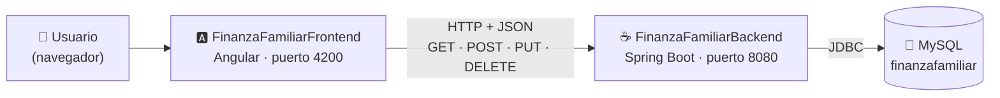
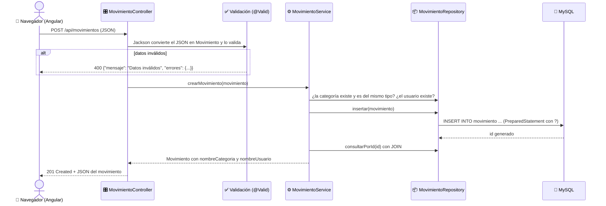
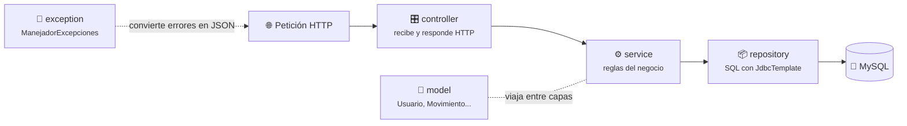
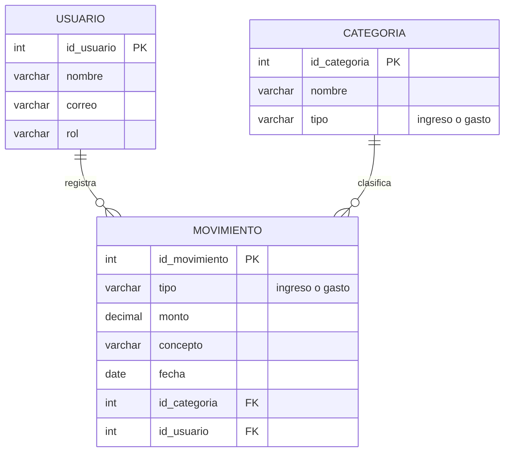

<div align="center">

# 💰 FinanzaFamiliarBackend

### Sistema de Contabilidad Familiar — API REST con Java + Spring Boot + JDBC + MySQL

Módulos de **Usuarios** y **Movimientos** (ingresos y gastos del hogar) expuestos como **servicios REST en formato JSON**, consumidos por el front-end en Angular [**FinanzaFamiliarFrontend**](https://github.com/moralessaiz/FinanzaFamiliarFrontend).


**SENA · Tecnólogo en Análisis y Desarrollo de Software (ADSO) · Ficha 3336193**
Evidencia `GA7-220501096-AA3-EV01` — Codificación de módulos del software stand-alone, web y móvil

</div>

---

## 📑 Tabla de contenido

1. [¿Qué hace este proyecto?](#-qué-hace-este-proyecto)
2. [Cómo encaja con el front-end](#-cómo-encaja-con-el-front-end)
3. [Requisitos previos](#-requisitos-previos)
4. [Paso 1 — Clonar el repositorio](#-paso-1--clonar-el-repositorio)
5. [Paso 2 — Crear la base de datos en MySQL Workbench](#-paso-2--crear-la-base-de-datos-en-mysql-workbench)
6. [Paso 3 — Ejecutar la API](#️-paso-3--ejecutar-la-api)
7. [Paso 4 — Probar que funciona](#-paso-4--probar-que-funciona)
8. [Servicios de la API](#-servicios-de-la-api)
9. [Validaciones y reglas de negocio](#-validaciones-y-reglas-de-negocio)
10. [¿Cómo funciona por dentro?](#-cómo-funciona-por-dentro)
11. [De Servlets + JSP a Spring Boot](#-de-servlets--jsp-a-spring-boot)
12. [Pruebas unitarias](#-pruebas-unitarias)
13. [Estructura del proyecto](#️-estructura-del-proyecto)
14. [Modelo de la base de datos](#️-modelo-de-la-base-de-datos)
15. [Configuración](#️-configuración)
16. [Solución de problemas](#-solución-de-problemas)
17. [Estándares de codificación](#-estándares-de-codificación)
18. [Trabajo en equipo con Git](#-trabajo-en-equipo-con-git)
19. [Autores](#-autores)

---

## 🎯 ¿Qué hace este proyecto?

Es el **back-end** del Sistema de Contabilidad Familiar. Recibe peticiones HTTP, aplica las validaciones y reglas del negocio, guarda los datos en MySQL por medio de **JDBC** y responde en **JSON**.

| Módulo | Tabla | Crear | Consultar | Actualizar | Eliminar | Extras |
|:--|:--|:--:|:--:|:--:|:--:|:--|
| 👤 **Usuarios** | `usuario` | ✅ | ✅ | ✅ | ✅ | Búsqueda por nombre, correo único, no se elimina si tiene movimientos |
| 💸 **Movimientos** | `movimiento` | ✅ | ✅ | ✅ | ✅ | Filtro por tipo, resumen (ingresos, gastos y saldo) |
| 🏷️ **Categorías** | `categoria` | — | ✅ | — | — | Lista para el formulario de movimientos |

### Historial de versiones

El proyecto ha crecido evidencia por evidencia. Las versiones anteriores siguen guardadas en Git:

| Versión | Evidencia | Tecnología | Dónde está |
|:--|:--|:--|:--|
| 1.0 | `GA7-220501096-AA2-EV01` y `AA2-EV02` | Java + JDBC (consola) y Servlets + JSP | Etiqueta Git [`aa2-servlets-jsp`](#ver-la-versión-anterior-con-servlets-y-jsp) |
| **2.0** | **`GA7-220501096-AA3-EV01`** | **Spring Boot (API REST) + JDBC** | **Rama actual** |

---

## 🔗 Cómo encaja con el front-end

La aplicación completa tiene **dos proyectos** que se comunican por HTTP:



| Proyecto | Repositorio | ¿Qué hace? |
|:--|:--|:--|
| ☕ **Back-end** (este) | [FinanzaFamiliarBackend](https://github.com/moralessaiz/FinanzaFamiliarBackend) | API REST: reglas de negocio y acceso a la base de datos |
| 🅰️ **Front-end** | [FinanzaFamiliarFrontend](https://github.com/moralessaiz/FinanzaFamiliarFrontend) | Pantallas en Angular que consumen esta API |

> [!IMPORTANT]
> Para usar la aplicación completa, **primero** se enciende este back-end y **después** el front-end. Si solo quieres probar la API, basta con este proyecto y el navegador (o Postman).

---

## 🧰 Requisitos previos

| Herramienta | Versión | ¿Para qué? | Descarga |
|:--|:--|:--|:--|
| ☕ **JDK** | 17 o superior | Compilar y ejecutar la API | [Oracle JDK](https://www.oracle.com/java/technologies/downloads/) |
| 🐬 **MySQL Server** | 8.0 o superior | Motor de base de datos | [MySQL Installer](https://dev.mysql.com/downloads/installer/) |
| 🛠️ **MySQL Workbench** | 8.0 o superior | Ejecutar los scripts SQL | Se instala junto con MySQL Installer |
| 💻 **IDE** | IntelliJ IDEA (recomendado) o NetBeans | Abrir y ejecutar el proyecto | [IntelliJ](https://www.jetbrains.com/idea/download/) · [NetBeans](https://netbeans.apache.org/front/main/download/) |
| 🌿 **Git** | Cualquiera | Clonar el repositorio | [git-scm.com](https://git-scm.com/downloads) |

> [!NOTE]
> **No necesitas instalar Maven, Tomcat ni descargar el driver de MySQL.** El proyecto trae **Maven Wrapper** (`mvnw` / `mvnw.cmd`), que descarga Maven la primera vez. Spring Boot trae su propio servidor **Tomcat embebido**, y el driver de MySQL se descarga como dependencia. Solo se necesita internet la primera vez.

---

## 📥 Paso 1 — Clonar el repositorio

```bash
git clone https://github.com/moralessaiz/FinanzaFamiliarBackend.git
cd FinanzaFamiliarBackend
```

> 💡 También puedes descargarlo como ZIP desde GitHub: botón verde **Code → Download ZIP**.

---

## 🐬 Paso 2 — Crear la base de datos en MySQL Workbench

> [!TIP]
> Si ya habías creado la base de datos `finanzafamiliar` para la versión con Servlets, **no tienes que hacer nada**: la API usa exactamente las mismas tablas y el mismo usuario. Pasa al [Paso 3](#️-paso-3--ejecutar-la-api).

El proyecto trae **dos scripts** en la carpeta [`sql/`](sql/), que se ejecutan **en este orden**:

| Orden | Script | ¿Qué hace? |
|:--:|:--|:--|
| 1️⃣ | [`finanzafamiliar_movimientos.sql`](sql/finanzafamiliar_movimientos.sql) | Crea la base de datos `finanzafamiliar`, las tablas `usuario`, `categoria` y `movimiento`, y los datos iniciales |
| 2️⃣ | [`crear_usuario_bd.sql`](sql/crear_usuario_bd.sql) | Crea el usuario de MySQL `finanza_user`, que es el que usa la API para conectarse |

1. Verifica que MySQL esté encendido: `Win + R` → `services.msc` → el servicio **MySQL80** debe estar **En ejecución**.
2. Abre **MySQL Workbench** y conéctate con **Local instance MySQL80** (usuario `root`).
3. **File → Open SQL Script…**, abre `sql/finanzafamiliar_movimientos.sql` y ejecútalo con el **rayo ⚡** (`Ctrl + Shift + Enter`).
4. Haz lo mismo con `sql/crear_usuario_bd.sql`. Al final aparece una pestaña con los permisos del usuario (`SHOW GRANTS`).

> [!CAUTION]
> Ejecuta `finanzafamiliar_movimientos.sql` **una sola vez**: si lo repites, los usuarios y categorías de ejemplo quedan duplicados. Para empezar de cero: `DROP DATABASE finanzafamiliar;` y vuelve a ejecutarlo.

Datos de conexión que usa la API (definidos en [`application.properties`](src/main/resources/application.properties)):

| Dato | Valor |
|:--|:--|
| 🖥️ Servidor | `localhost:3306` |
| 🗄️ Base de datos | `finanzafamiliar` |
| 👤 Usuario | `finanza_user` |
| 🔑 Contraseña | `Finanza2026*` |

---

## ▶️ Paso 3 — Ejecutar la API

### 🟣 Con IntelliJ IDEA (recomendado)

1. **File → Open…** y selecciona la carpeta `FinanzaFamiliarBackend` (la que tiene el `pom.xml`). Si pregunta, **Trust Project**.
2. Espera a que termine la barra de progreso inferior (Maven descarga Spring Boot y el driver de MySQL).
3. Verifica el JDK: **File → Project Structure → Project → SDK** = 17 o superior.
4. Abre `src/main/java/com/finanzafamiliar/contabilidad/FinanzaFamiliarApplication.java`.
5. Haz clic en el ▶️ **verde** al lado de `public static void main` → **Run 'FinanzaFamiliarApplication'**.

### 🔵 Con NetBeans

1. **File → Open Project…** y selecciona la carpeta `FinanzaFamiliarBackend` (ícono de Maven).
2. Clic derecho sobre el proyecto → **Run Maven → Goals…** → escribe `spring-boot:run` → marca **Remember as:** `Spring Boot` → **OK**.

### ⌨️ Desde la terminal

```powershell
# Windows (PowerShell o CMD)
.\mvnw.cmd spring-boot:run
```

```bash
# Git Bash, macOS o Linux
./mvnw spring-boot:run
```

### ✅ Resultado esperado

En la consola debe aparecer:

```text
 :: Spring Boot ::               (v3.5.16)
...
Tomcat started on port 8080 (http) with context path '/'
Started FinanzaFamiliarApplication in 7.193 seconds
Conexion JDBC exitosa a: jdbc:mysql://localhost:3306/finanzafamiliar?...
Motor de base de datos: MySQL 8.0.39
```

> [!NOTE]
> La consola se queda "pegada": es normal, la API está esperando peticiones. **Déjala abierta** mientras uses el front-end. Para apagarla: botón ⏹ del IDE o `Ctrl + C` en la terminal.

---

## 🧪 Paso 4 — Probar que funciona

Con la API encendida, abre estas direcciones en el navegador. Deben mostrar datos en JSON:

| URL | Debe mostrar |
|:--|:--|
| http://localhost:8080/api/categorias | Las 4 categorías |
| http://localhost:8080/api/usuarios | Los usuarios registrados |
| http://localhost:8080/api/usuarios?nombre=cris | Solo los usuarios con "cris" en el nombre |
| http://localhost:8080/api/movimientos?tipo=gasto | Solo los gastos |
| http://localhost:8080/api/movimientos/resumen | Total de ingresos, gastos y saldo |

Para probar `POST`, `PUT` y `DELETE` se usa el **front-end en Angular** o una herramienta como [Postman](https://www.postman.com/downloads/). Ejemplo desde Git Bash:

```bash
curl -X POST http://localhost:8080/api/usuarios \
     -H "Content-Type: application/json" \
     -d '{"nombre": "Laura Morales", "correo": "laura@correo.com", "rol": "Integrante"}'
```

---

## 🔌 Servicios de la API

Dirección base: **`http://localhost:8080/api`**

### 👤 Usuarios — `UsuarioController`

| Método | Ruta | Descripción | Respuesta correcta | Errores posibles |
|:--:|:--|:--|:--:|:--|
| `GET` | `/usuarios` | Lista los usuarios (opcional `?nombre=texto`) | `200` | — |
| `GET` | `/usuarios/{id}` | Consulta un usuario | `200` | `404` no existe |
| `POST` | `/usuarios` | Registra un usuario | `201` | `400` datos inválidos · `409` correo repetido |
| `PUT` | `/usuarios/{id}` | Actualiza un usuario | `200` | `400` · `404` · `409` |
| `DELETE` | `/usuarios/{id}` | Elimina un usuario | `204` | `404` · `409` tiene movimientos |

```json
{ "nombre": "Laura Morales", "correo": "laura@correo.com", "rol": "Integrante" }
```

### 💸 Movimientos — `MovimientoController`

| Método | Ruta | Descripción | Respuesta correcta | Errores posibles |
|:--:|:--|:--|:--:|:--|
| `GET` | `/movimientos` | Lista los movimientos (opcional `?tipo=ingreso`, `gasto` o `todos`) | `200` | `400` tipo desconocido |
| `GET` | `/movimientos/resumen` | Total de ingresos, total de gastos, saldo y cantidad | `200` | — |
| `GET` | `/movimientos/{id}` | Consulta un movimiento | `200` | `404` |
| `POST` | `/movimientos` | Registra un movimiento | `201` | `400` datos inválidos o regla incumplida |
| `PUT` | `/movimientos/{id}` | Actualiza un movimiento | `200` | `400` · `404` |
| `DELETE` | `/movimientos/{id}` | Elimina un movimiento | `204` | `404` |

```json
{
  "tipo": "gasto",
  "monto": 45000.50,
  "concepto": "Mercado semanal",
  "fecha": "2026-10-12",
  "idCategoria": 3,
  "idUsuario": 1
}
```

Al consultar, cada movimiento trae además `idMovimiento`, `nombreCategoria` y `nombreUsuario`.

### 🏷️ Categorías — `CategoriaController`

| Método | Ruta | Descripción | Respuesta |
|:--:|:--|:--|:--:|
| `GET` | `/categorias` | Lista las categorías ordenadas por tipo y nombre | `200` |

### Formato de los errores

Todos los errores tienen la misma forma, para que el front-end los pueda mostrar sin esfuerzo:

```json
{
  "mensaje": "Datos inválidos",
  "errores": {
    "monto": "El monto debe ser mayor que cero",
    "fecha": "La fecha no puede ser posterior a hoy"
  }
}
```

| Código | Significado | Cuándo pasa |
|:--:|:--|:--|
| `200` OK | Todo bien | Consultar o actualizar |
| `201` Created | Se creó el registro | `POST` correcto |
| `204` No Content | Se eliminó, no hay nada que devolver | `DELETE` correcto |
| `400` Bad Request | Los datos enviados no son válidos | Campos vacíos, formatos incorrectos, categoría de otro tipo |
| `404` Not Found | No existe | Id inexistente o ruta mal escrita |
| `409` Conflict | Choca con datos existentes | Correo repetido, eliminar un usuario con movimientos |
| `503` Service Unavailable | No hay conexión con MySQL | Servicio MySQL apagado |

---

## ✅ Validaciones y reglas de negocio

Las validaciones se declaran con anotaciones en los modelos ([`Usuario.java`](src/main/java/com/finanzafamiliar/contabilidad/model/Usuario.java) y [`Movimiento.java`](src/main/java/com/finanzafamiliar/contabilidad/model/Movimiento.java)). Spring las revisa **antes** de llamar al controlador gracias a `@Valid`. El front-end repite las mismas reglas para avisar antes de enviar, pero **la API siempre vuelve a validar**, porque la validación del navegador se puede saltar.

### Usuario

| Campo | Regla | Anotación | Mensaje |
|:--|:--|:--|:--|
| `nombre` | Obligatorio | `@NotBlank` | El nombre es obligatorio |
| `nombre` | Máximo 80 caracteres | `@Size(max = 80)` | El nombre no puede superar 80 caracteres |
| `nombre` | Solo letras (con tildes y ñ) y espacios | `@Pattern` | El nombre solo puede contener letras y espacios |
| `correo` | Obligatorio, máximo 100 | `@NotBlank`, `@Size` | — |
| `correo` | Formato `texto@dominio.ext` | `@Email` | El correo electrónico no es válido |
| `correo` | No repetido | `UsuarioService` | Ya existe un usuario registrado con el correo … (`409`) |
| `rol` | `Administrador` o `Integrante` | `@Pattern` | El rol debe ser Administrador o Integrante |
| — | No se elimina si tiene movimientos | `UsuarioService` | No se puede eliminar a … porque tiene N movimiento(s) (`409`) |

Además, el servicio **normaliza** los datos: quita espacios sobrantes del nombre (`"  Laura   Morales "` → `"Laura Morales"`) y guarda el correo en minúscula.

### Movimiento

| Campo | Regla | Anotación | Mensaje |
|:--|:--|:--|:--|
| `tipo` | `ingreso` o `gasto` | `@Pattern` | El tipo debe ser ingreso o gasto |
| `monto` | Obligatorio y mayor que cero | `@NotNull`, `@DecimalMin("0.01")` | El monto debe ser mayor que cero |
| `monto` | Máximo 10 enteros y 2 decimales (`DECIMAL(12,2)`) | `@Digits` | El monto admite máximo 10 dígitos enteros y 2 decimales |
| `monto` | Debe ser un número | Jackson | El valor no tiene un formato válido |
| `concepto` | Obligatorio, máximo 150 | `@NotBlank`, `@Size` | El concepto no puede superar 150 caracteres |
| `fecha` | Obligatoria, formato `aaaa-mm-dd`, debe existir | `@NotNull`, Jackson | El valor no tiene un formato válido (por ejemplo `2026-02-31`) |
| `fecha` | No puede ser futura | `@PastOrPresent` | La fecha no puede ser posterior a hoy |
| `idCategoria` | Debe existir **y ser del mismo tipo** | `MovimientoService` | La categoría Salario es de tipo ingreso y no se puede usar en un gasto |
| `idUsuario` | Debe existir | `MovimientoService` | El usuario con id … no existe |

---

## 🧠 ¿Cómo funciona por dentro?

### Recorrido de una petición



### Las capas



| Paquete | Responsabilidad | Anotación de Spring |
|:--|:--|:--|
| `controller` | Recibe la petición, la valida y devuelve la respuesta. **No** tiene SQL ni reglas | `@RestController` |
| `service` | Reglas del negocio: correo único, categoría del mismo tipo, no borrar usuarios con movimientos | `@Service` |
| `repository` | SQL con `JdbcTemplate` y parámetros `?` (evita la inyección SQL) | `@Repository` |
| `model` | Clases que representan una fila de cada tabla, con sus validaciones | — |
| `exception` | Excepciones propias y `ManejadorExcepciones`, que las traduce a códigos HTTP | `@RestControllerAdvice` |
| `config` | CORS (permite que Angular llame a la API) y verificación de la conexión al iniciar | `@Configuration`, `@Component` |

### Inyección de dependencias

En la versión con Servlets cada clase creaba sus objetos (`new UsuarioDAO()`). Ahora **Spring los crea y los entrega** por el constructor:

```java
@Service
public class UsuarioService {
    private final UsuarioRepository usuarioRepository;

    // Spring ve que el servicio necesita un UsuarioRepository y se lo pasa automaticamente
    public UsuarioService(UsuarioRepository usuarioRepository, MovimientoRepository movimientoRepository) { ... }
}
```

Así, en las pruebas se puede entregar un repositorio **simulado** (mock) sin tocar la base de datos.

---

## 🔄 De Servlets + JSP a Spring Boot

Así se transformó cada pieza de la versión anterior (`aa2-servlets-jsp`):

| Versión con Servlets (AA2) | Versión con Spring Boot (AA3) | ¿Qué cambió? |
|:--|:--|:--|
| `ConexionBD.java` + `DriverManager` | `application.properties` + pool HikariCP | Spring abre, reutiliza y cierra las conexiones |
| `UsuarioDAO`, `MovimientoDAO`, `CategoriaDAO` | `UsuarioRepository`, `MovimientoRepository`, `CategoriaRepository` | El mismo SQL, ahora con `JdbcTemplate` (sin `try-with-resources` manual) |
| *(no existía)* | `UsuarioService`, `MovimientoService` | Nueva capa con las reglas del negocio |
| `ListarUsuariosServlet`, `RegistrarUsuarioServlet`… | `UsuarioController`, `MovimientoController` | `@WebServlet` + `doGet/doPost` → `@GetMapping`, `@PostMapping`, `@PutMapping`, `@DeleteMapping` |
| `request.getParameter("nombre")` | `@RequestBody Usuario` / `@RequestParam` | Spring convierte el JSON en objetos Java |
| `forward` a una JSP | `return usuario;` | Spring convierte el objeto en JSON |
| `if (nombre == null ...)` en el servlet | `@NotBlank`, `@Size`, `@Email`… + `@Valid` | Validación declarativa |
| `catch (SQLException e)` en cada servlet | `ManejadorExcepciones` | Un solo lugar para todos los errores |
| JSP en `WEB-INF/vistas` + `HtmlUtil` | **FinanzaFamiliarFrontend** (Angular) | La vista ahora es otro proyecto. Angular escapa el texto automáticamente (protección XSS) |
| Jetty con `mvn jetty:run` (puerto 8081) | Tomcat embebido con `mvnw spring-boot:run` (puerto 8080) | Ya no es un `.war`, es un `.jar` ejecutable |
| `Main.java` (prueba en consola) | Pruebas JUnit en `src/test` | Pruebas automáticas que se repiten con un comando |

---

## 🧪 Pruebas unitarias

El proyecto tiene **32 pruebas** con JUnit 5, Mockito y MockMvc. **No necesitan MySQL**: los repositorios y servicios se reemplazan por simulacros (mocks).

```powershell
.\mvnw.cmd test        # Windows
./mvnw test            # Git Bash, macOS, Linux
```

En IntelliJ: clic derecho sobre la carpeta `src/test/java` → **Run 'All Tests'**.

| Clase de prueba | Qué comprueba |
|:--|:--|
| `UsuarioControllerTest` (9) | Respuestas `200/201/204`, campos vacíos, nombre con números o `<script>`, correo inválido, rol desconocido, nombre de más de 80 caracteres, id no numérico, `404` y `409` |
| `MovimientoControllerTest` (11) | Monto negativo, con 3 decimales o con texto, tipo desconocido, fecha futura o inexistente (`2026-02-31`), concepto de más de 150 caracteres, JSON mal escrito, resumen y ruta inexistente |
| `UsuarioServiceTest` (6) | Normalización del nombre y el correo, correo repetido, editar sin chocar consigo mismo, no eliminar con movimientos |
| `MovimientoServiceTest` (6) | Categoría de otro tipo, categoría o usuario inexistente, filtro por tipo, eliminar inexistente |

Resultado esperado:

```text
Tests run: 32, Failures: 0, Errors: 0, Skipped: 0
BUILD SUCCESS
```

---

## 🗂️ Estructura del proyecto

```text
FinanzaFamiliarBackend/
├── 📄 pom.xml                       ← Dependencias: Spring Web, JDBC, Validation, MySQL, pruebas
├── 📄 mvnw · mvnw.cmd · .mvn/       ← Maven Wrapper (no hay que instalar Maven)
├── 📄 README.md
├── 📁 sql/
│   ├── finanzafamiliar_movimientos.sql   ← 1️⃣ Base de datos, tablas y datos iniciales
│   └── crear_usuario_bd.sql              ← 2️⃣ Usuario de MySQL para la aplicación
└── 📁 src/
    ├── 📁 main/
    │   ├── 📁 java/com/finanzafamiliar/contabilidad/
    │   │   ├── FinanzaFamiliarApplication.java    ← Clase principal (arranca Spring Boot)
    │   │   ├── 📁 config/
    │   │   │   ├── CorsConfig.java                ← Permite peticiones desde Angular (puerto 4200)
    │   │   │   └── VerificacionConexion.java      ← Prueba la conexión a MySQL al iniciar
    │   │   ├── 📁 controller/
    │   │   │   ├── UsuarioController.java         ← /api/usuarios
    │   │   │   ├── MovimientoController.java      ← /api/movimientos
    │   │   │   └── CategoriaController.java       ← /api/categorias
    │   │   ├── 📁 service/
    │   │   │   ├── UsuarioService.java            ← Reglas de usuarios
    │   │   │   └── MovimientoService.java         ← Reglas de movimientos
    │   │   ├── 📁 repository/
    │   │   │   ├── UsuarioRepository.java         ← SQL de la tabla usuario
    │   │   │   ├── MovimientoRepository.java      ← SQL de la tabla movimiento (+ resumen)
    │   │   │   └── CategoriaRepository.java       ← SQL de la tabla categoria
    │   │   ├── 📁 model/
    │   │   │   ├── Usuario.java · Movimiento.java · Categoria.java
    │   │   │   └── ResumenMovimientos.java        ← record con los totales
    │   │   └── 📁 exception/
    │   │       ├── ManejadorExcepciones.java      ← Convierte los errores en JSON
    │   │       ├── RecursoNoEncontradoException.java   (404)
    │   │       ├── ReglaNegocioException.java          (400)
    │   │       └── ConflictoException.java             (409)
    │   └── 📁 resources/
    │       └── application.properties             ← Puerto, conexión a MySQL y CORS
    └── 📁 test/java/com/finanzafamiliar/contabilidad/
        ├── 📁 controller/   UsuarioControllerTest, MovimientoControllerTest
        └── 📁 service/      UsuarioServiceTest, MovimientoServiceTest
```

---

## 🗄️ Modelo de la base de datos



- Un **usuario** puede registrar muchos **movimientos**, y una **categoría** puede clasificar muchos **movimientos**.
- La base de datos **no cambió** respecto a la versión con Servlets.

---

## ⚙️ Configuración

Toda la configuración está en [`src/main/resources/application.properties`](src/main/resources/application.properties). Los datos sensibles se pueden cambiar con **variables de entorno**, sin modificar el archivo:

| Variable de entorno | Valor por defecto | ¿Para qué? |
|:--|:--|:--|
| `DB_HOST` | `localhost` | Servidor de MySQL |
| `DB_USUARIO` | `finanza_user` | Usuario de MySQL |
| `DB_CLAVE` | `Finanza2026*` | Contraseña de MySQL |
| `CORS_ORIGEN` | `http://localhost:4200` | Dirección del front-end que puede usar la API |

Ejemplo en PowerShell:

```powershell
$env:DB_CLAVE = 'MiOtraClave'
.\mvnw.cmd spring-boot:run
```

En IntelliJ: **Run → Edit Configurations… → Environment variables** → `DB_CLAVE=MiOtraClave`.

---

## 🩺 Solución de problemas

| ❌ Mensaje de error | 🔍 Causa | ✅ Solución |
|:--|:--|:--|
| `NO fue posible conectarse a MySQL: Access denied for user 'finanza_user'` | No se ha creado el usuario de MySQL | Ejecuta `sql/crear_usuario_bd.sql` en Workbench ([Paso 2](#-paso-2--crear-la-base-de-datos-en-mysql-workbench)) |
| `Unknown database 'finanzafamiliar'` | No se ha creado la base de datos | Ejecuta `sql/finanzafamiliar_movimientos.sql` |
| `Communications link failure` | El servidor MySQL está apagado | Inicia el servicio **MySQL80** en `services.msc` |
| La API responde `503` "No fue posible acceder a la base de datos" | Igual que el anterior | Enciende MySQL; no hace falta reiniciar la API |
| `Port 8080 was already in use` | Otra aplicación (o una ejecución anterior de la API) usa el puerto | Detén la otra ejecución con ⏹, o cambia `server.port` (y `urlApi` en el front-end) |
| `JAVA_HOME not found` / `java no se reconoce` al usar `mvnw` | El JDK no está en el `PATH` | Instala el JDK 17+ o ejecuta desde IntelliJ |
| `invalid target release: 17` | El JDK instalado es anterior a la versión 17 | Instala JDK 17 o superior y selecciónalo en el IDE |
| `Failed to delete ...\target\...` | OneDrive o el IDE tienen bloqueada la carpeta `target` | Cierra la ejecución anterior y vuelve a intentar; o ejecuta sin `clean` |
| El front-end dice *"No hay conexión con la API"* | La API está apagada | Ejecuta el [Paso 3](#️-paso-3--ejecutar-la-api) y recarga la página |
| En el navegador aparece un error de **CORS** | El front-end corre en otra dirección o puerto | Cambia `CORS_ORIGEN` o `finanzafamiliar.cors.origen-permitido` |
| Clases en rojo / `package org.springframework... does not exist` | Maven no ha descargado las dependencias | IntelliJ: panel **Maven** → 🔄 **Reload All Maven Projects** (necesita internet) |

---

## 📐 Estándares de codificación

El código sigue el documento de estándares del proyecto (evidencia `GA7-220501096-AA1-EV02`):

| Elemento | Convención | Ejemplo |
|:--|:--|:--|
| 📦 Paquetes | minúsculas, dominio inverso, una capa por paquete | `com.finanzafamiliar.contabilidad.service` |
| 🏷️ Clases | `UpperCamelCase`, sustantivo + rol de la capa | `UsuarioController`, `MovimientoRepository` |
| 🔤 Variables y atributos | `lowerCamelCase` | `idUsuario`, `cantidadMovimientos` |
| ⚙️ Métodos | `lowerCamelCase`, verbos | `crearUsuario()`, `consultarPorId()` |
| 🔒 Constantes | `UPPER_SNAKE_CASE` | `SQL_INSERTAR`, `TIPO_INGRESO` |
| 📝 Comentarios | Javadoc `/** ... */` en clases y métodos públicos | — |
| 🚨 Excepciones | Excepciones propias por tipo de error, traducidas en un solo lugar | `ConflictoException` → `409` |
| ↔️ Identación | 4 espacios, máximo 120 caracteres por línea | — |

---

## 🌿 Trabajo en equipo con Git

| Rama / etiqueta | ¿Qué es? |
|:--|:--|
| `main` | Versión estable y revisada |
| `dev-cristhian` | Trabajo de Cristhian |
| `dev-amalfi` | Trabajo de Amalfi |
| 🏷️ `aa2-servlets-jsp` | Versión con Servlets + JSP (evidencias AA2) |

Flujo de trabajo:

```bash
git switch dev-tu-nombre
git pull origin main
# ... hacer cambios ...
git add .
git commit -m "Descripción corta y clara del cambio"
git push origin dev-tu-nombre
```

Luego, en GitHub, abre un **Pull Request** de `dev-tu-nombre` hacia `main` y haz el **merge**.

### Ver la versión anterior con Servlets y JSP

```bash
git switch --detach aa2-servlets-jsp   # ver la version AA2 (solo lectura)
git switch dev-cristhian               # volver a la version actual
```

> 💡 Para publicar la etiqueta en GitHub: `git push origin aa2-servlets-jsp`.

---

## 👥 Autores

<table>
  <tr>
    <td align="center"><b>Amalfi Aya de Gómez</b><br/><sub>Aprendiz ADSO</sub></td>
    <td align="center"><b>Cristhian Andrés Morales Saiz</b><br/><sub>Aprendiz ADSO</sub></td>
  </tr>
</table>

<div align="center">

**Servicio Nacional de Aprendizaje — SENA**
Tecnólogo en Análisis y Desarrollo de Software · Ficha 3336193 · 2026

</div>
